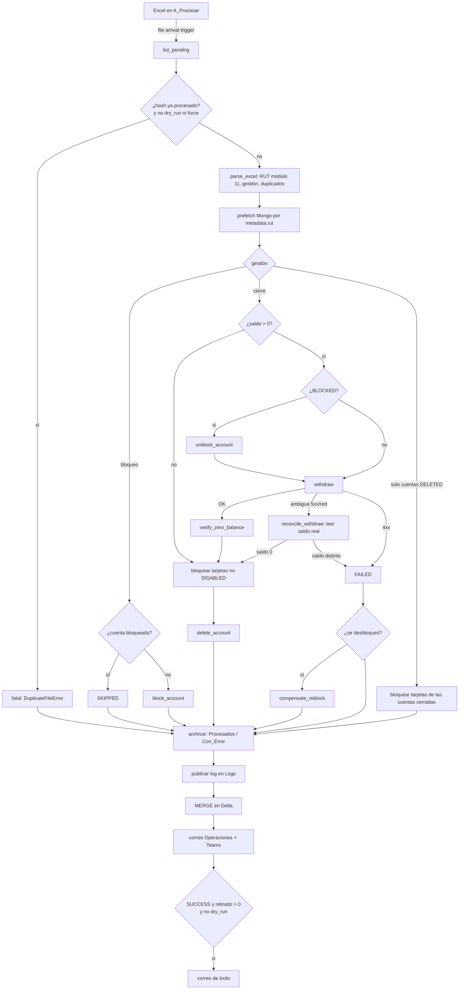

# aml-account-closure

Proceso de Databricks que **bloquea o cierra cuentas por AML** a partir del Excel que el equipo de
Cumplimiento deja en un Volume. Es la versión empaquetada del notebook `accounts_ops`: **misma lógica y
mismos resultados**, organizada en capas, con pruebas, CI/CD e infraestructura como código.

- Se ejecuta **solo en Databricks** (cluster existente, DBR 15.4 LTS, Python 3.11).
- Las pruebas corren en GitHub Actions con dobles de prueba (sin Databricks, Mongo ni red).

## Qué hace

Cada vez que llega un archivo a `A_Procesar` (*file arrival trigger*), el job procesa **todos** los `.xlsx`
pendientes, del más antiguo al más nuevo:

1. Calcula el hash del contenido. Si ya hay un run real (no dry-run) con ese hash en estado SUCCESS/PARTIAL,
   el archivo se marca como duplicado (salvo `force=true`).
2. Lee el Excel, valida y normaliza cada RUT (módulo 11) y la gestión (`bloqueo` / `cierre`).
3. Busca la cuenta en Mongo por `accounts.metadata.rut` (una sola consulta por archivo; no hay índice por RUT).
4. Aplica la gestión, hasta 4 cuentas en paralelo:
   - **Bloqueo**: bloquea la cuenta si no lo está. No toca tarjetas, salvo que todas las cuentas del RUT
     ya estén cerradas.
   - **Cierre**: desbloquea (si está BLOCKED) → retira todo el saldo → verifica saldo 0 → bloquea las
     tarjetas → cierra. Si algo falla después de desbloquear, **re-bloquea** la cuenta (compensación).
   - **Cuenta ya cerrada (DELETED)**: la cuenta no se toca, pero sus tarjetas se bloquean igual.
5. Mueve el archivo a `Procesados` (o a `Con_Error` si el run es FAILED), copia el log a `Logs`,
   guarda el resultado en Delta y notifica por correo y Teams.

## Arquitectura

```
notebooks/run_aml_account_closure.py   entrada delgada: widgets + %run corporativo + utils → inyección
src/aml_account_closure/
├── composition.py      composition root: arma API (real / dry-run / JSON dev) y repositorio
├── config.py           Config inmutable, load_config, constantes de Mongo/API
├── ports.py            Protocols (repositorio, API, store, archivos, notificaciones, dependencias externas)
├── domain/             modelos, errores, RUT, decisiones puras (sin I/O)
├── application/        retry, StepTrail, bloqueo/cierre (saga), orquestación del archivo
└── adapters/           Excel, Volume, Mongo (Repository), API backoffice, Delta, notificaciones, logs, JSON dev
```

| Patrón | Dónde |
|---|---|
| Repository | `adapters/mongo_repo.py` (`MongoRepo`), `adapters/dev_json.py` (`JsonAccountStore`) |
| Adapter | `backoffice_api.py`, `delta_store.py`, `volume_files.py`, `excel_reader.py`, `notifier.py`, `log_publisher.py` |
| Decorator | `mongo_call` (errores de pymongo → `TransientError`), `MirroredApi` (refleja efectos en el JSON de dev) |
| Strategy | `HANDLERS` en `application/account_actions.py` |
| Saga con compensación | `handle_close`: re-bloqueo si se desbloqueó y no se cerró |
| Taxonomía de errores | `TransientError` (reintentar) · `AmbiguousError` (conciliar) · `BusinessError` (no reintentar) |
| Retry | `RetryPolicy`: backoff exponencial con jitter (API/Mongo: 3 intentos · verificación de saldo: 5) |
| Composition root | `composition.py` + notebook de entrada |

### Flujo



### Reglas que conviene recordar

- **Retiro**: no es idempotente. Solo se reintenta ante `ConnectTimeout` (la conexión nunca se estableció)
  o `429`. Con un 5xx, un 408 o un error de red después de conectar, **no se reintenta**: se concilia
  leyendo el saldo real (`reconcile_withdraw`).
- **Estados de cuenta**: `ENABLED`, `BLOCKED`, `DISABLED`, `DELETED`. Una cuenta `DISABLED` termina en
  FAILED y pasa a revisión manual. "Cerrada" es `DELETED`. Si el status es desconocido, la cuenta no se opera.
- **Tarjetas**: se bloquean (PUT con `status=DISABLED`) todas las que no estén `DISABLED`, incluidas las `BLOCKED`.
- **Estado del run**: FAILED si hubo error general o no hay filas, o si fallaron todas las filas.
  PARTIAL si falló alguna. SUCCESS si no falló ninguna. Un run FAILED hace fallar el job y activa las
  alertas nativas.

## Formato del Excel

Un `.xlsx` (primera hoja) con encabezado en la fila 1. No se distingue mayúsculas de minúsculas y se
ignoran los espacios alrededor del nombre de columna.

| Columna | Nombres aceptados | Valores |
|---|---|---|
| RUT | `rut`, `rut_usuario`, `rut usuario`, `rut_cliente` | `12.345.678-5`, `12345678-5`, `123456785`, con ceros a la izquierda, o un número guardado por Excel (`123456785.0`). DV `K` o `k`. |
| Gestión | `type`, `tipo`, `gestion`, `gestión`, `accion`, `acción` | `bloqueo` / `bloquear`, `cierre` / `cerrar` |

- Las filas vacías se ignoran. El número de fila del reporte es la fila real del Excel.
- Un RUT o una gestión inválida → la fila queda FAILED en `validate_input`. El resto del archivo se procesa.
- Si el mismo RUT aparece con la misma gestión, se procesa una vez y las filas repetidas quedan SKIPPED.
- Si aparece con gestiones distintas, todas sus filas quedan FAILED.
- Si faltan columnas, el archivo no se puede leer o no tiene filas, el error es fatal y el archivo va a `Con_Error`.

Ejemplo:

| RUT | Tipo |
|---|---|
| 12.345.678-5 | cierre |
| 1.000.005-K | bloqueo |

## Configuración

Nada específico de un ambiente está hardcodeado en el paquete: llega como **parámetro del job**, que se
alimenta de una **variable del bundle**, cuyo valor viene del GitHub Environment al desplegar
(`BUNDLE_VAR_<nombre>`).

| Variable del bundle | Ejemplo | Origen en GitHub (Environment) |
|---|---|---|
| `cluster_id` | `<cluster_id>` | var `CLUSTER_ID` |
| `service_principal_application_id` | `<sp_application_id>` | var `SERVICE_PRINCIPAL_APPLICATION_ID` |
| `utils_dir` | `<ruta_carpeta_utils>` (opcional) | var `UTILS_DIR` |
| `api_base_url` | `<api_base_url>` | var `API_BASE_URL` |
| `api_key_scope` / `api_key_name` | `<scope_api_key>` / `<key_api_key>` | vars `API_KEY_SCOPE` / `API_KEY_NAME` |
| `mongo_connection` / `mongo_secret` | `<mongo_connection>` / `<mongo_secret>` | vars `MONGO_CONNECTION` / `MONGO_SECRET` |
| `aml_dir` | `/Volumes/<catalogo>/<schema>/<volume>/<carpeta_aml>` | var `AML_DIR` |
| `tables_schema` | `gold_cumplimiento.analytics` (por defecto) | var `TABLES_SCHEMA` |
| `logo_url` | `<logo_url>` | var `LOGO_URL` |
| `dev_json_accounts` / `dev_json_cards` | `<ruta_json_cuentas>` (solo dev) | vars `DEV_JSON_ACCOUNTS` / `DEV_JSON_CARDS` |
| `operator_user` | `<usuario_operador>` | secret `OPERATOR_USER` |
| `email_recipients` | `<correo_1>, <correo_2>` | secret `EMAIL_RECIPIENTS` |
| `success_recipients` | `<correo_1>, <correo_2>` (vacío = no se envía) | secret `SUCCESS_RECIPIENTS` |
| `teams_chat_id` | `<teams_chat_id>` | secret `TEAMS_CHAT_ID` |
| `treasury_source_account` / `treasury_target_account` | `<cuenta_origen>` / `<cuenta_destino>` | secrets `TREASURY_SOURCE_ACCOUNT` / `TREASURY_TARGET_ACCOUNT` |

- Los destinatarios son **un solo string separado por comas**, igual que en el notebook. Se envían en una
  sola llamada a `send_email`.
- Los **secretos** (API key) se leen con `dbutils.secrets.get(scope, key)`. El repo solo conoce el nombre
  del scope y de la key. Las credenciales de Mongo las resuelve `conectar_mongo` del `%run` corporativo.
- Las tablas son `{tables_schema}.{env}_ops_cierre_accounts_{runs|steps|results}`. El código las crea con
  `CREATE TABLE IF NOT EXISTS` y escribe con `MERGE`, que es idempotente.
- **Modo dev con JSON**: solo si `env=dev` y `dev_json_accounts` tiene valor. En prod, `load_config`
  falla si recibe ese valor.

### Dependencias externas (no están en el repo)

| Dependencia | Origen | Contrato en el paquete |
|---|---|---|
| `conectar_mongo`, `desconectar_mongo` | `%run /Workspace/Procesos_Automaticos/Funciones/Funciones_Conexion_MongoDB_MI` | `ports.MongoConnector`, `ports.MongoDisconnector` |
| `send_email`, `send_message` | módulo `utils` de Databricks | `ports.EmailSender`, `ports.TeamsSender` |
| `dbutils.secrets`, `spark` | runtime de Databricks | `ports.SecretReader`, `SparkDeltaStore` |
| `pymongo` / `bson` | cluster existente | (dependencia de desarrollo para los tests) |

## Despliegue

### Bundle (`databricks.yml`)

- Construye el wheel (`python -m build --wheel`, con `dynamic_version` para que el cluster existente lo
  reinstale en cada despliegue) y sube el notebook de entrada.
- Despliega el job `aml-account-closure-<target>` con:
  - *file arrival trigger* sobre `${aml_dir}/A_Procesar/`;
  - `max_concurrent_runs: 1` y cola activada;
  - parámetros `env`, `dry_run`, `force` y la configuración.
- Targets:
  - **dev** (`mode: development`): trigger **pausado**, `dry_run=true`, se ejecuta a mano. Dev y prod
    comparten `A_Procesar`; con el trigger activo en los dos, ambos procesarían cada archivo.
  - **prod** (`mode: production`): trigger activo, `dry_run=false`, `run_as` el service principal.

> **Importante:** la carpeta de procesados (`Procesados`, `Con_Error`, `Logs`) debe estar **fuera** de la
> carpeta vigilada `A_Procesar`. Hoy son carpetas hermanas dentro de `<carpeta_aml>`. Si quedaran dentro
> de `A_Procesar`, mover el archivo volvería a disparar el trigger.

### Terraform (`infra/terraform`)

Solo lo que el bundle no cubre. El job y las tablas no van en Terraform.

| Recurso | Detalle |
|---|---|
| Volume | Se **importa** (`imports.tf`), con `prevent_destroy`, porque es compartido. |
| Carpetas | Un `.keep` en `A_Procesar`, `Procesados`, `Con_Error` y `Logs`. UC no tiene recurso "carpeta". |
| Grants | `databricks_grant` no autoritativo. Cumplimiento: `READ_VOLUME` + `WRITE_VOLUME`. Job: lo mismo + `USE_SCHEMA`/`CREATE_TABLE`/`SELECT`/`MODIFY` en el schema de las tablas. UC no permite permisos por carpeta: Cumplimiento puede escribir en todo el Volume. |
| Secret scopes | Solo existencia (importados) + ACL `READ` para el SP. **Nunca valores.** |

```bash
cd infra/terraform
cp backend.hcl.example backend.hcl            # completar
cp terraform.tfvars.example terraform.tfvars  # completar
terraform init -backend-config=backend.hcl
terraform plan    # revisar: los import no deben proponer cambios destructivos
terraform apply
```

### GitHub

| Workflow | Cuándo | Qué |
|---|---|---|
| `ci.yml` | PR y push a `main` | ruff (lint + format), mypy, pytest con cobertura, build del wheel, `bundle validate` (dev y prod), `terraform fmt -check` + `validate` |
| `deploy.yml` | manual (`workflow_dispatch`) | tests → `bundle validate` → `bundle deploy` al target elegido. `prod` usa un Environment con aprobación. |

**Secretos y variables a crear:**

- Secretos del repo (para `bundle validate` en CI): `DATABRICKS_HOST`, `DATABRICKS_CLIENT_ID`, `DATABRICKS_CLIENT_SECRET`.
- Environments `dev` y `prod`. En `prod`, activar *Required reviewers*.
  - Secrets: `DATABRICKS_HOST`, `DATABRICKS_CLIENT_ID`, `DATABRICKS_CLIENT_SECRET`, `OPERATOR_USER`,
    `EMAIL_RECIPIENTS`, `SUCCESS_RECIPIENTS`, `TEAMS_CHAT_ID`, `TREASURY_SOURCE_ACCOUNT`, `TREASURY_TARGET_ACCOUNT`.
  - Variables: `CLUSTER_ID`, `SERVICE_PRINCIPAL_APPLICATION_ID`, `UTILS_DIR`, `API_BASE_URL`, `API_KEY_SCOPE`,
    `API_KEY_NAME`, `MONGO_CONNECTION`, `MONGO_SECRET`, `AML_DIR`, `TABLES_SCHEMA`, `LOGO_URL`,
    `DEV_JSON_ACCOUNTS` y `DEV_JSON_CARDS` (estas dos, solo en dev).

## Operación

| Necesito… | Cómo |
|---|---|
| Probar sin efectos | Ejecutar el job con `dry_run=true`. No llama a la API (solo registra lo que haría), no verifica saldo y **no mueve el archivo**. Sí lee Mongo, guarda en Delta con `dry_run=true` y envía el correo a Operaciones y el mensaje de Teams marcados como DRY-RUN. Nunca envía el correo de éxito. |
| Reprocesar un archivo ya procesado | Volver a dejarlo en `A_Procesar` y ejecutar con `force=true`. |
| Revisar un caso | `{env}_ops_cierre_accounts_results` (una fila por fila del Excel) y `..._steps` (cada paso, intentos y error). |
| Ver el log | `<carpeta_aml>/Logs/accounts_ops_<fecha>.log` |
| Archivo con error general | Queda en `Con_Error` y el job termina en error (alerta nativa). |

## Desarrollo

```bash
python -m venv .venv && . .venv/bin/activate   # Windows: .venv\Scripts\activate
pip install -e ".[dev]"
pre-commit install
ruff check . && ruff format --check . && mypy && pytest
```

Las pruebas usan `mongomock` (Mongo), `responses` (API), un store en memoria (Delta), `tmp_path` (Volume) y
fakes de `dbutils` y de las notificaciones. Las esperas de los reintentos se anulan. Todos los datos son
inventados.

Ver [`docs/OBSERVACIONES.md`](docs/OBSERVACIONES.md) para los posibles bugs y mejoras detectados en la
migración, que no se aplicaron.
